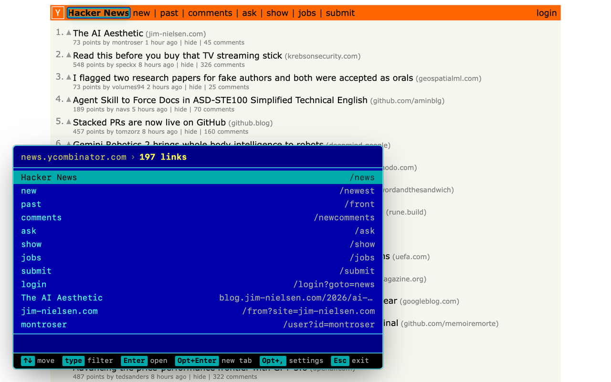
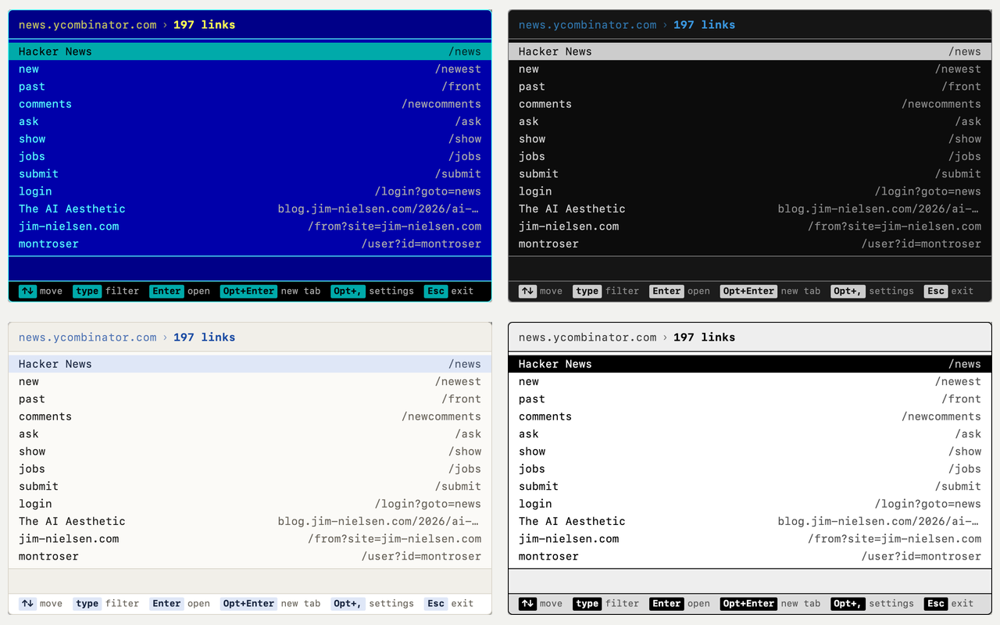

# FarLink

Every link on a page, in one keyboard-driven list.

Press a key and FarLink opens a panel in the corner of the page listing every
link on it: the title on the left, the address on the right. Type to filter by
either. Arrows move, Enter opens.

It is drawn like an orthodox file manager, because that is what it is for.
Far Manager and yazi are the reference points.



## When it helps

Link hints (Vimium, Surfingkeys) are the fastest way to click one link you can
already see. FarLink is for the other case: you do not know where the thing is,
or there is no "the thing" yet.

- A page with four hundred links you want to search by address.
- Working through a list rather than picking one item out of it.
- Anything below the fold, or behind a scroll, or repeated forty times.

If you use a link-hint extension, keep it. They coexist.

## Install

[**Add to Chrome**][store] — from the Chrome Web Store.

To build it yourself instead:

```bash
pnpm install
pnpm build
```

Then open `chrome://extensions`, turn on Developer mode, and use **Load
unpacked** on `build/chrome-mv3`.

[store]: https://chromewebstore.google.com/detail/chfppficohobddfeafagjaecdbacepmh

## Keys

Press `Ctrl+Shift+Period` (`Cmd+Shift+Period` on macOS), or click the toolbar
button. That is the only way in, by design: see Permissions below.

**If the shortcut does nothing, another app has it.** A global hotkey wins
before Chrome ever sees the key. Click the toolbar button instead, then rebind
the shortcut at `chrome://extensions/shortcuts`. The toolbar tooltip tells you
which chord is actually bound, or that none is. Existing installs keep whatever
was already bound; Chrome only applies a suggested key on first install.

| Key | What it does |
| --- | --- |
| `↑` `↓` | Move. `PgUp` `PgDn` by a screenful, `Home` `End` for the ends |
| any character | Start filtering, matching the title and the address |
| `Enter` | Open the link |
| `Alt+Enter` | Open it in a background tab |
| `Alt+Shift+Enter` | Open it in a new tab and switch to it |
| `Alt+,` | Settings: theme, size, corner |
| `Alt+arrows` | Move the panel to any corner (`Shift+arrows` works too) |
| `Alt+S` | Cycle the size: compact, normal, full |
| `Alt+T` | Next theme |
| `Esc` | Close |

On macOS every `Alt` is `Option`, and the panel says `Opt+` in its own key bar.

No letter is bound to movement. Letters belong to what you are typing, so
filtering starts the moment you press one. There is no prefix key.

## Permissions

FarLink asks for **no access to any website**, at install or ever. The manifest
declares neither `host_permissions` nor `optional_host_permissions`, so there is
no site list to grant and none to revoke.

It runs on `activeTab`: pressing the shortcut or clicking the button grants
access to that one tab, for that one invocation, and nothing else. Nothing runs
on a page you have not opened FarLink on.

That is the reason there is one way in. A single key that opened the panel would
need a script already running on every page you visit, which is exactly the
access this design refuses.

It makes no network requests. No server, no analytics, no account. Your
settings live in your own browser profile. See [SECURITY.md](SECURITY.md) and
[store/privacy.md](store/privacy.md).

## Themes

Thirteen, cycled with `Alt+T`: Far Manager, Yazi, Catppuccin Mocha, Nord,
Paper, Solarized Light, High Contrast, Mono, Macintosh 1984, Windows XP, New
Vegas, IBM 3270, Commodore 64.



Every one is checked by test for WCAG AA contrast on body text and on each
text-on-fill pair. Adding one means adding a single entry to `FLAVORS` in
`lib/ui/palettes.ts`; the tests iterate the list, so a new theme is contrast
checked without touching a test.

## Platforms

macOS, Windows and Linux. The differences that matter are behavioral, not
cosmetic, and they live in `lib/platform.ts`: on macOS Option rewrites
`event.key`, so `Option+T` arrives as `†`; on Windows and Linux AltGr arrives
as Ctrl+Alt, which is also how `\` is typed on several European layouts.
Chords are matched on `event.code`, which is also why they work on a non-Latin
layout.

One deliberate collision: on Windows and Linux, `Alt+←`/`→` is the browser's
Back and Forward, and FarLink takes them while the panel is open.
`Shift+arrows` docks the panel too, so that route stays free.

## Development

```bash
pnpm dev      # hot-reloading build; load build/chrome-mv3-dev unpacked
pnpm check    # format check, typecheck, tests
pnpm zip      # store-ready package
```

[CONTRIBUTING.md](CONTRIBUTING.md) covers the layout of the code, the
conventions, and what to expect from a pull request.
[docs/architecture.md](docs/architecture.md) explains how the extension is put
together and why the awkward parts are the way they are.

## Status

Version 0.2.0, [on the Chrome Web Store][store] since 31 July 2026. It builds,
it runs, and it is tested on live pages, but it is still early and has had few
users. Bug reports and rough edges are welcome; see
[CONTRIBUTING.md](CONTRIBUTING.md).

## Licence

[MIT](LICENSE), © 2026 [Far Chinberdiev](https://fardev.io).

FarLink is not affiliated with Far Manager. The name is a nod to it.
